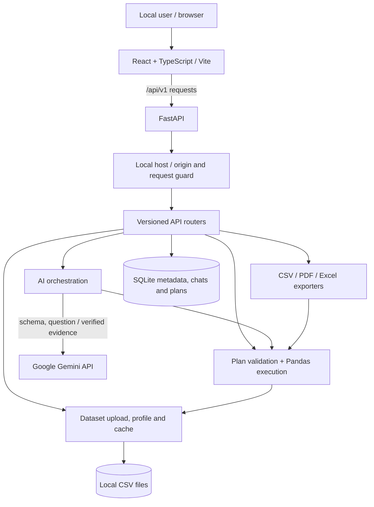
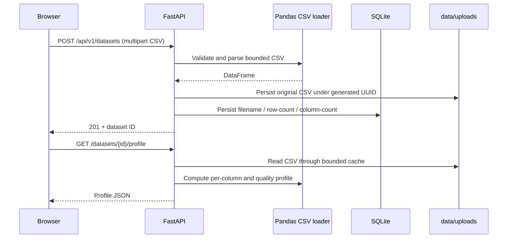
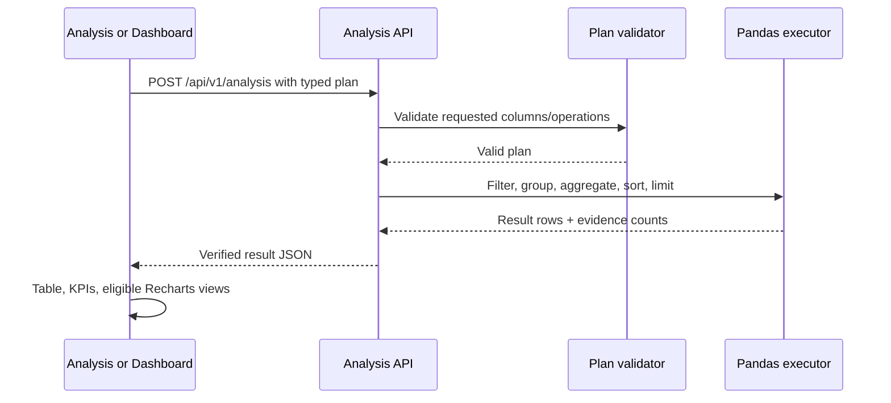

# System Architecture

> **Full Stack AI Data Analyst** — implementation-oriented architecture of the local-development MVP, reviewed against repository `main` on 2026-10-17.

## 1. Overview

The application separates presentation, API validation, deterministic analytics, optional AI planning/explanation, and local persistence. **AI does not compute the authoritative numerical answer**: Pandas does. The project currently targets a single user running the stack on their own computer.



The guard is implemented as middleware around the FastAPI application. For clarity, the diagram shows it between requests and route handlers. The diagram does not imply any cloud storage or server-side authentication.

## 2. Technologies

| Responsibility | Implementation |
|---|---|
| Client UI | React 19, TypeScript, Vite 8 |
| Charts | Recharts 3; chart module lazy loading |
| UI design | Custom CSS, Nothing-inspired monochrome design, dark/light mode |
| HTTP | Browser Fetch API; Vite `/api` proxy in development |
| Web API | FastAPI and Pydantic |
| Computation | Pandas and NumPy |
| AI | `google-genai` SDK and Google Gemini API |
| Persistence | SQLite + SQLAlchemy ORM |
| CSV parsing | Pandas CSV loader with input limits |
| In-process optimization | Bounded, fingerprint-checked CSV DataFrame cache |
| PDF | ReportLab |
| Excel | XlsxWriter with native Excel charts |
| Backend tooling | Python 3.12, uv, pytest, Ruff |
| Frontend tests | Vitest; TypeScript compilation and Vite build |

## 3. Runtime topology

Local development uses two processes:

```text
Browser http://localhost:5173
  |
  +-- Vite development frontend
         |
         +-- /api/* proxy --> FastAPI http://127.0.0.1:8000
                                  |
                                  +-- data/app.db (SQLite)
                                  +-- data/uploads/<uuid>.csv
                                  +-- optional Gemini HTTPS requests
```

The backend reads paths derived from `backend/app/core/config.py`; the SQLite file and CSV upload directory are under the repository's **root `data/` directory**, not the `backend/` directory. Python dependencies are managed through `backend/pyproject.toml` and `backend/uv.lock`. In the UI, data-driven pages are switched through application state rather than an external router.

### Recommended local launch (Windows PowerShell)

Terminal 1:

```powershell
Set-Location D:\full-stack-ai-data-analyst
uv sync --project .\backend --python 3.12
uv run --project .\backend uvicorn app.main:app --app-dir backend --host 127.0.0.1 --port 8000 --reload
```

Terminal 2:

```powershell
Set-Location D:\full-stack-ai-data-analyst
npm.cmd --prefix .\frontend install
npm.cmd --prefix .\frontend run dev
```

Backend `.env` values are read by `backend/app/ai/client.py`, with `GEMINI_API_KEY` and optional `GEMINI_MODEL`. Normal deterministic analysis, uploads, and recognized overview questions can work without calling Gemini; quantitative AI Chat questions require a configured Gemini key and working API access.

## 4. Backend layers

```text
backend/
  app/
    main.py                      FastAPI application, lifespan, middleware
    api/v1/                      HTTP routers and endpoint handlers
    schemas/                     Pydantic request/response contract models
    analytics/                   CSV parsing, plan validation, Pandas executor
    ai/                          Gemini client, AI planning and explanation
    services/                    Profiling, cache, overview, report builders
    models/                      SQLAlchemy models
    db/                          Database engine and sessions
    core/                        Config and local request security
  tests/                         Unit and integration tests
  pyproject.toml
  uv.lock
```

**Separation of responsibilities:**

1. A route accepts an HTTP request and locates the stored dataset.
2. Pydantic validates request structure and types.
3. `validate_analysis_plan` checks columns, filter/aggregation compatibility and sort aliases against the DataFrame.
4. `execute_analysis` applies filters, groups/aggregates, sorts and applies result limits.
5. The route returns structured data or sends it to a report builder or Gemini explainer.

A user-supplied prompt is not executed as Python code, SQL, or a shell command.

## 5. Frontend modules

```text
frontend/src/
  App.tsx                        App shell, view switcher and theme
  pages/
    DatasetsPage.tsx             Upload, list, preview and profile
    AnalystPage.tsx              Deterministic analysis, saves and exports
    ChatPage.tsx                 AI questions and conversation history
    DashboardPage.tsx            Metrics, filters and charts
  components/
    charts/VerifiedChart.tsx     Chart modes and Excel export affordance
    charts/LazyVerifiedChart.tsx Deferred chart loading
    chat/                       Chat message and conversation UI
  services/                      Shared HTTP client and typed API wrappers
  types/                         TypeScript contracts
  index.css                      Layout, theme and view transitions
```

Chart modes exposed by the shared visualization component: **bar, horizontal bar, line, area, pie, donut**. Line/area depend on a useful ordered axis; pie/donut depend on complete additive results with nonnegative values. Charts are rendered from returned Pandas result rows, not invented example data. Only the **Analysis** and **Dashboard** views pass the Excel-export handler; AI Chat does not.

The app's view transitions use a brief CSS entrance animation and respect `prefers-reduced-motion`; navigation also scrolls to the top with reduced-motion awareness.

## 6. End-to-end data flows

### 6.1 Upload and profile



CSV size limit: **10 MiB**; row limit: **100,000**; column limit: **100**. This is a bounded local data-analysis tool, not an unlimited data warehouse.

### 6.2 Deterministic analysis



The generic analysis API allows up to three grouping columns and five metrics, but chart and AI-planner requirements can be narrower.

### 6.3 AI question and explanation

1. User selects a dataset and submits a question.
2. The backend retrieves the dataset and checks whether this is a recognized overview request.
3. **Overview branch:** local profiling produces a descriptive answer and a `local-profile` label; no Gemini request is made.
4. **Quantitative branch:** Gemini receives the schema and question and proposes a structured plan. The backend validates that plan, then Pandas executes it.
5. Gemini is sent **verified evidence** (not the full CSV as part of the implemented planning/explanation flow) to generate an explanation. If explanation fails, a verified-results fallback can be returned.
6. User and assistant messages, plus any plan/analysis evidence, are stored in SQLite and linked to a conversation.

Supported AI questions are intentionally limited to the planner's implemented filter, group, aggregate and sort operations. It is not a general-purpose data-science coding agent.

### 6.4 Saved analyses

The Analysis module can persist named `AnalysisRequest` plans in SQLite, retrieve them later, rename or update them, and re-run them against the same dataset. Data values are calculated at run time; a saved analysis is **not** a snapshot of a report's results.

### 6.5 Exports

```text
Verified plan --> Pandas executor
                    |--> CSV writer: flat returned result data
                    |--> ReportLab: report PDF
                    |--> XlsxWriter: Chart + Verified Data worksheets
                                      (native editable Excel chart)
```

All exports re-execute a validated plan. Excel chart exports take an additional chart type and metric alias. Chart data is assembled from returned result rows; chart format restrictions are rechecked server-side. When a result is truncated, exports include a truncation header, and Excel marks the data sheet as partial.

## 7. CSV cache design

`backend/app/services/csv_cache.py` uses an in-process `OrderedDict` with an `RLock` and per-file fingerprints (device, inode, size, modification and change times). Each cached DataFrame is **deep-copied before being handed to callers** to prevent accidental mutation of a shared cached object.

- Maximum **2 cached dataset entries**.
- Maximum **64 MiB** combined approximate in-memory DataFrame size.
- Revalidates fingerprints; invalidates a removed/deleted dataset.
- Parses outside the central lock for more responsive concurrent reads.
- Lives only within one Python process; not a cross-worker or durable cache.

## 8. Data persistence and deletion

SQLite tables store metadata, conversations/messages and saved analysis plans. Actual uploaded CSV content is kept as files in `data/uploads/`. Dataset deletion stages its file, removes dependent SQLite records and then cleans up the staged file, with rollback/recovery handling on failure. `Conversation.messages` has an ORM delete-orphan cascade. See [DATABASE.md](DATABASE.md).

## 9. Security boundaries and limitations

- Local host allowlist and write-origin checks apply to the API; see [SECURITY.md](SECURITY.md).
- API request sizes and operation-specific request rates are bounded, and exports sanitize spreadsheet formula-like strings.
- There is **no** account system, tenant isolation, user authorization, hosted deployment architecture, job queue, external cache or background workers in the current implementation.
- For this reason, do **not** expose the present backend as a public service without authentication, authorization, stronger isolation and deployment controls.

## 10. Verification and next steps

As last reported on **2026-10-17**: backend `pytest` **75 passed**, frontend Vitest **18 passed**, Ruff passed, frontend production build passed, and all six manual browser checks passed. These are a known verified snapshot, not a guarantee of future runs.

Useful commands:

```powershell
uv run --project .\backend ruff check .\backend\app .\backend\tests
uv run --project .\backend pytest -q
npm.cmd --prefix .\frontend run test
npm.cmd --prefix .\frontend run build
```

See [API.md](API.md), [ROADMAP.md](ROADMAP.md), [PRD.md](PRD.md) and the [root README](../README.md).
