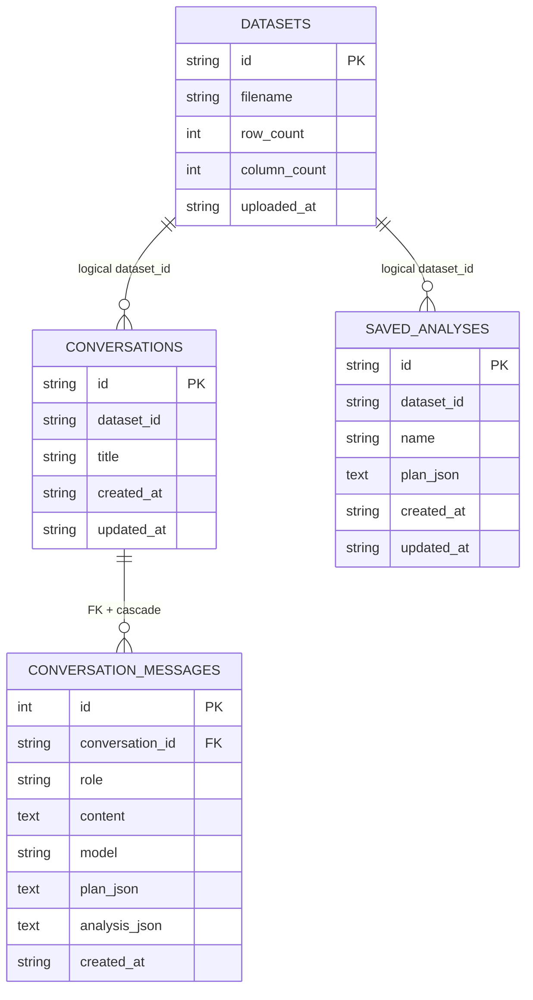

# Database and Persistence Design

> **Project:** Full Stack AI Data Analyst
> **Current implementation:** SQLite with SQLAlchemy ORM. Source models reviewed on 2026-10-17.
> **Audience:** Maintainers, contributors and reviewers.

## 1. Persistence model

The application uses **two types of local storage**:

1. **SQLite** stores uploaded-file metadata, AI conversation history and saved analytical plans.
2. **CSV files** store the original uploaded datasets; Pandas loads these into memory to perform computations.

SQLite is **not** the primary store of all CSV rows. There is no vector database or analytical data warehouse in the current implementation.

### Default paths

From the repository root:

```text
Full-Stack-AI-data-analyst/
  data/
    app.db                       SQLite database, created by app startup
    uploads/
      <dataset-uuid>.csv         Uploaded CSV file contents
    samples/
      sales_sample.csv           Versioned example dataset
  backend/
    app/models/                  SQLAlchemy models
    app/db/session.py            Engine, session factory, Base
    app/core/config.py           Storage directory settings
```

`backend/app/core/config.py` defines `DATABASE_FILE = PROJECT_ROOT / "data" / "app.db"` and `UPLOAD_DIR = PROJECT_ROOT / "data" / "uploads"`. The engine is SQLite (`sqlite+pysqlite`) and creates the database file as necessary. The active `backend/app/db/session.py` uses this explicit file path rather than reading `DATABASE_URL` from the `.env` example.

## 2. Entity relationships



**Important:** Only `conversation_messages.conversation_id` is declared as a database `ForeignKey` in the current ORM models. `conversations.dataset_id` and `saved_analyses.dataset_id` are indexed strings, and the dataset relationship is enforced by application logic rather than database foreign keys. The diagram labels these as *logical* relationships intentionally.

## 3. Table reference

### 3.1 `datasets`

Defined in `backend/app/models/dataset.py`.

| Column | SQLAlchemy type | Rules | Description |
|---|---|---|---|
| `id` | `String(36)` | Primary key | Generated dataset UUID |
| `filename` | `String(255)` | Required | Original sanitized filename (basename) |
| `row_count` | `Integer` | Required | Number of parsed data rows |
| `column_count` | `Integer` | Required | Number of CSV columns |
| `uploaded_at` | `String(40)` | Required, UTC ISO timestamp default | Time of upload |

The physical file is stored under `data/uploads/<id>.csv`, not as a BLOB inside SQLite.

### 3.2 `conversations`

Defined in `backend/app/models/conversation.py`.

| Column | SQLAlchemy type | Rules | Description |
|---|---|---|---|
| `id` | `String(36)` | Primary key | Conversation UUID |
| `dataset_id` | `String(36)` | Required, indexed | Associated dataset (logical reference) |
| `title` | `String(120)` | Required | Conversation name, initially derived from question |
| `created_at` | `String(40)` | Required, UTC ISO default | Created timestamp |
| `updated_at` | `String(40)` | Required, UTC ISO default | Last updated timestamp |

`Conversation.messages` is an ORM relationship with `cascade="all, delete-orphan"` and orders messages by ascending message ID.

### 3.3 `conversation_messages`

Defined in `backend/app/models/message.py`.

| Column | SQLAlchemy type | Rules | Description |
|---|---|---|---|
| `id` | `Integer` | Autoincrementing primary key | Message order/identifier |
| `conversation_id` | `String(36)` | Required, indexed FK to `conversations.id` | Owning conversation |
| `role` | `String(20)` | Required | `user` or `assistant` in current chat flow |
| `content` | `Text` | Required | Message body |
| `model` | `String(120)` | Nullable | Model label or `local-profile` |
| `plan_json` | `Text` | Nullable | Serialized structured analysis plan |
| `analysis_json` | `Text` | Nullable | Serialized verified analysis evidence |
| `created_at` | `String(40)` | Required, UTC ISO default | Message timestamp |

Current chat flow persists a user message and an assistant message after it computes an answer. A recognized overview question stores an assistant message without plan and analysis JSON. A quantitative reply may store both.

**Privacy note:** Conversations can contain user questions, assistant text and computed analytical results. Treat `app.db` as potentially sensitive even though the raw uploaded CSV files are stored separately.

### 3.4 `saved_analyses`

Defined in `backend/app/models/saved_analysis.py`.

| Column | SQLAlchemy type | Rules | Description |
|---|---|---|---|
| `id` | `String(36)` | Primary key | Saved-analysis UUID |
| `dataset_id` | `String(36)` | Required, indexed | Associated dataset (logical reference) |
| `name` | `String(120)` | Required | User-supplied display name |
| `plan_json` | `Text` | Required | Serialized `AnalysisRequest` plan |
| `created_at` | `String(40)` | Required, UTC ISO default | Created timestamp |
| `updated_at` | `String(40)` | Required, UTC ISO default | Last modification timestamp |

The saved plan contains grouping/filter/metric/sort/limit settings; results are **not** cached in this table. Re-running a saved plan loads the dataset and performs the calculation again.

## 4. Schema initialization and lifecycle

`backend/app/main.py` imports all four ORM model modules and runs:

```python
Base.metadata.create_all(bind=engine)
```

inside the FastAPI lifespan startup. This creates missing tables for a local development database. It is **not a schema migration system** and does not automatically evolve existing tables when columns change. Alembic is listed as a backend dependency, but this documentation does not assume a full versioned migration workflow has been implemented.

The normal dependency `get_db()` yields a SQLAlchemy `Session` from `SessionLocal` and closes it after the request. Handlers commit writes explicitly. The test suite uses isolated in-memory SQLite engines for many integration cases.

## 5. Read/write workflows

### Upload

1. Validate file name, byte limits and CSV structure.
2. Parse a Pandas DataFrame to determine row and column counts.
3. Generate a UUID and save the original CSV bytes to `data/uploads/<uuid>.csv`.
4. Insert a `datasets` metadata record.
5. On persistence failure, roll back and attempt file cleanup.

### Read and compute

Dataset preview, profile, Analysis, Dashboard and AI Chat fetch the stored CSV through a bounded CSV cache. The cache stores up to **2 entries**, bounded to **64 MiB** of estimated DataFrame memory, with file fingerprint checks and deep-copy isolation. This cache is not persisted across server restarts.

### Conversation

1. Find or create a conversation for the selected dataset.
2. Compute local overview or AI-assisted verified analysis.
3. Save user and assistant message records, alongside optional model/plan/analysis metadata.
4. Retrieve conversations sorted by last update, with a maximum of 50 in list responses.

### Saved analysis

Validate the plan against the current stored dataset, save `plan_json`, then retrieve, rename, update, rerun or delete it via `/api/v1/saved-analyses`.

## 6. Deletion semantics

`DELETE /api/v1/datasets/{dataset_id}` is intentionally more involved than deleting a single row:

1. Rename an existing CSV file to a temporary hidden `.deleting` path, making it unavailable to active reads.
2. Find conversations and saved analyses whose `dataset_id` matches the dataset.
3. Delete those ORM objects (including conversations' messages through ORM cascade), delete dataset metadata and commit.
4. If database commit fails, roll back and attempt to restore the original CSV filename.
5. After successful database commit, remove the staged file and invalidate its cached DataFrame.

If the final staged-file cleanup fails, the database deletion is still considered committed and a warning is logged for manual cleanup. The deletion handler includes defensive failure handling for file restoration failures.

Deleting an individual conversation also deletes its messages through the ORM relationship. Deleting a saved analysis removes only that named plan, not the uploaded dataset.

## 7. Inspecting the database (local development)

The SQLite database is a normal `.db` file. With Python 3.12 from the project environment:

```powershell
Set-Location D:\full-stack-ai-data-analyst
@'
import sqlite3
from pathlib import Path

path = Path("data/app.db")
if not path.exists():
    raise SystemExit("Start the backend first to create data/app.db")

with sqlite3.connect(path) as db:
    for (name,) in db.execute(
        "SELECT name FROM sqlite_master WHERE type='table' ORDER BY name"
    ):
        print(name)
'@ | uv run --project .\backend python -
```

This command reads schema names without modifying the database. Do not commit `data/app.db` or a private user's uploaded CSV files to GitHub.

## 8. Design trade-offs and future changes

**Current strengths:** Simple local installation, easy SQLite inspection, persistent conversations and plans, deterministic calculation, and bounded in-process caching.

**Current constraints:** No user accounts/tenant isolation; no declared dataset foreign keys; no automated durable backup/restore workflow; no proven production migration process; SQLite is not designed here for high-volume multi-user writes; entire datasets are processed by Pandas rather than an external analytical database.

**Future improvements (not implemented):** Define and test Alembic migrations; document a verified backup/restore procedure; consider stronger relational constraints and explicit foreign-key enforcement; add retention/deletion options; migrate to more capable storage only if multi-user scale actually requires it.

## 9. Related reading

[API reference](API.md) · [Architecture](ARCHITECTURE.md) · [Security](SECURITY.md) · [Roadmap](ROADMAP.md) · [Root README](../README.md)
